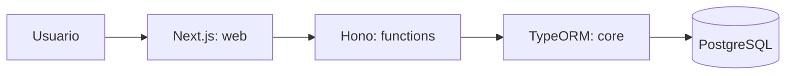

# Arquitectura

- `packages/web/src/app`: páginas y ruta `/api` que integra la API en el despliegue web. `components`, `hooks` y `services` contienen interfaz y llamadas del cliente.
- `packages/functions/src/app.ts`: monta Hono bajo `/api`, CORS, acceso a datos, errores, autenticación y rutas.
- `packages/functions/src/domains`: controladores, servicios, esquemas y rutas por dominio.
- `packages/core/src/domains`: entidades y repositorios. `src/database/data-source.ts` registra el modelo y las migraciones.
- `packages/core/src/migrations`: historial del esquema PostgreSQL.

Una petición entra por una ruta, el controlador valida la entrada y llama al servicio. El servicio aplica reglas y persiste mediante `core`. Para añadir un campo, revisa contrato HTTP, servicio, entidad y migración si persiste, y finalmente la web.

Las reglas de negocio más delicadas están en [juzgamiento](dominios/juzgamiento.md) y [sincronización](dominios/sincronizacion.md).
