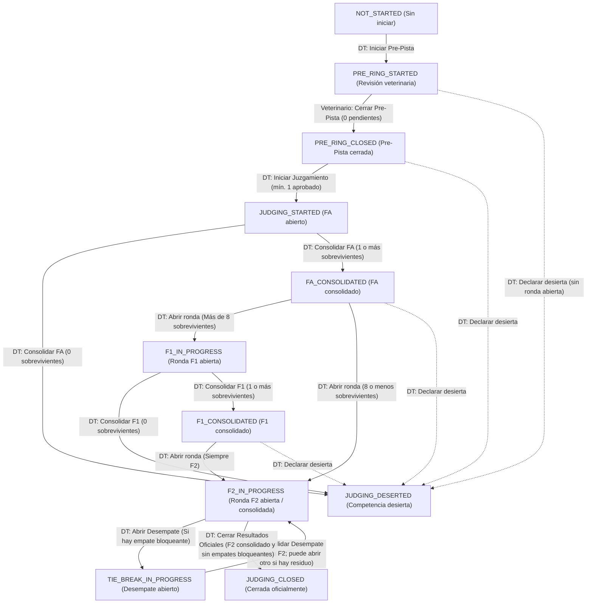

# Guía de Reglas de Negocio, Roles y Flujos de Juzgamiento — Pegasus

Esta documentación describe **exactamente lo que está implementado hoy en el código fuente de Pegasus**. Está redactada para que cualquier persona —técnica o no técnica— pueda entender cómo funciona el sistema de principio a fin, qué hace cada rol y qué reglas reglamentarias (FEDEQUINAS) gobiernan cada etapa de una competencia.

---

## 1. Visión general del sistema

Pegasus divide su operación en **dos espacios completamente separados**:

1. **Panel Administrativo (`/`, `/fairs`, `/people`, `/sincronizador`, `/settings`, etc.)**:
   - Exclusivo para el **Usuario Root**.
   - Se utiliza para cargar la información de las ferias desde Fedequinas, generar códigos de acceso al personal, asignar sillas de jueces, administrar recordatorios, configurar cintas/distintivos y consultar indicadores.
2. **Portal de Staff (`/staff` y `/staff/categories/[id]`)**:
   - Exclusivo para el personal operativo de pista: **Director Técnico**, **Veterinario Autorizado** y **Jueces**.
   - Se utiliza en tiempo real durante la feria para ejecutar el control veterinario (Pre-Pista) y el juzgamiento completo de cada categoría (FA, F1, F2, Desempates y Cierre Oficial).

> [!NOTE]
> El sistema bloquea automáticamente el cruce entre portales: si un usuario `Root` intenta entrar a `/staff`, es redirigido al panel administrativo; si un integrante del Staff intenta entrar al panel administrativo, es redirigido a `/staff`.

---

## 2. Roles del sistema: qué hace cada uno

Aunque el catálogo de Fedequinas contiene 28 roles distintos, en Pegasus existen **4 roles operativos activos**.

| Característica | Usuario Root | Director Técnico | Veterinario Autorizado | Juez |
|---|---|---|---|---|
| **Código de rol Fedequinas** | No aplica (sistema) | `3` | `Z` | `2` |
| **Forma de ingreso** | Correo y contraseña (`/login`) | Código de 6 caracteres (`/login/staff`, prefijo `DTF`) | Código de 6 caracteres (`/login/staff`, prefijo `VTF`) | Código de 6 caracteres (`/login/staff`, prefijo `JFQ`) |
| **Portal al que accede** | Panel Administrativo | Portal de Staff | Portal de Staff | Portal de Staff |
| **Duración de sesión** | 8 horas | 8 horas | 8 horas | 8 horas |
| **Qué categorías ve** | Todas (consulta admin) | Todas las de su feria (incluso sin iniciar) | Solo las que ya iniciaron Pre-Pista | Solo las que ya iniciaron Juzgamiento (`JUDGING_STARTED` en adelante) |

---

### 2.1 Usuario Root (Administrador del sistema)
Es el encargado de la preparación previa, configuración global y supervisión administrativa. **No interviene en pista** (no aprueba ejemplares, no vota ni cierra rondas).

**¿Qué hace?**
- **Sincroniza datos oficiales de Fedequinas (`/sincronizador`):** Sube archivos `.xlsx` (máx. 10 MB, una sola feria por archivo) en un orden obligatorio de 3 pasos:
  1. `FEH_FERIAS` (datos de la feria).
  2. `FEH_PERSONAL_FERIA` (personal asignado).
  3. `FEH_INSCRIPCIONES_FERIA_PADRES` (ejemplares y categorías inscritas).
  - Primero previsualiza errores y advertencias (el sistema genera un token de confirmación válido por 30 minutos) y solo permite aplicar si hay **0 errores**.
- **Gestiona accesos del personal (`/people`):** Genera automáticamente (ej. `DTF001`, `VTF001`, `JFQ001`) o asigna manualmente códigos únicos de 6 caracteres alfanuméricos para Directores Técnicos, Veterinarios y Jueces.
- **Asigna asientos fijos de jueces (`/fairs/[id]`):** Define el asiento (`1` al `5`) de cada juez en una feria. Si asigna un asiento ya ocupado por otro juez, el sistema intercambia ambos asientos automáticamente.
- **Configura parámetros y catálogos (`/settings` y `/recordatorios`):**
  - Define el límite máximo de ejemplares que un juez puede seleccionar en **F1** (`F1_MAX_SELECTIONS`: entre `1` y `50`, valor por defecto `10`).
  - Edita las **cintas/distintivos de premiación** para los puestos 1.º al 5.º (nombre, color y estado activo).
  - Crea, edita o desactiva el catálogo de **recordatorios** (nombre único e icono) que los jueces usan como apuntes privados en pista.
- **Consulta general (`/`, `/fairs`, `/horses`, `/categories`):** Ve indicadores del dashboard, listado de ferias, inscripciones, ejemplares, categorías y resultados sincronizados. *(En entornos que no son producción, también cuenta con una herramienta de limpieza de datos de sincronización).*

---

### 2.2 Director Técnico (Coordinador del flujo en pista)
Es el "director de orquesta" de la competencia. Controla cuándo empieza y cuándo se consolida cada etapa, pero **nunca califica ni selecciona ejemplares** y **no realiza ni cierra el chequeo veterinario**.

**¿Qué hace?**
- **Inicia la Pre-Pista:** Toma una categoría en estado `NOT_STARTED` y abre la revisión veterinaria (notifica a los veterinarios).
- **Inicia el Juzgamiento (FA):** Una vez que el veterinario cierra la Pre-Pista y existe al menos **1 ejemplar aprobado**, habilita el ingreso a pista y notifica a los jueces.
- **Atiende solicitudes de "Repetir Pista" en FA:** Cuando un juez solicita que un ejemplar repita la pista durante FA, el Director Técnico recibe la notificación y marca la solicitud como **Ejecutada** cuando se realiza en pista.
- **Consolida cada fase:**
  - **Consolida FA** cuando todos los jueces activos han cerrado su tarjeta FA.
  - **Abre la siguiente ronda** (el sistema decide automáticamente si corresponde abrir **F1** o saltar directo a **F2**).
  - **Consolida F1** cuando todos los jueces cerraron F1.
  - **Consolida F2** cuando todos los jueces cerraron F2.
- **Gestiona desempates:** Si F2 (o un desempate previo) arroja un empate bloqueante, elige las pruebas reglamentarias permitidas y abre la ronda de desempate; luego la consolida cuando todos los jueces cierran.
- **Cierra oficialmente la categoría o la declara desierta:**
  - Ejecuta el **Cierre Oficial** cuando F2 está consolidado y no quedan empates bloqueantes ni desempates abiertos.
  - Puede **declarar desierta** la competencia en cualquier momento antes del cierre (siempre que no haya una ronda abierta en curso).
- **Reinicio para pruebas:** Dispone de una acción para reiniciar por completo una categoría a `NOT_STARTED` (borra chequeos, tarjetas, rondas, eventos y notificaciones de esa categoría).

---

### 2.3 Veterinario Autorizado (Control de Pre-Pista)
Es el responsable de verificar que los ejemplares inscritos sean aptos para entrar a pista antes de que los jueces puedan verlos.

**¿Qué hace?**
- **Revisa ejemplares en Pre-Pista:** Solo cuando la categoría está en estado `PRE_RING_STARTED`, revisa cada ejemplar inscrito y le asigna uno de estos estados:
  - `APPROVED` (Aprobado): pasa a pista.
  - `REJECTED` (No aprobado): queda fuera del juzgamiento. **Exige obligatoriamente** seleccionar un motivo oficial del catálogo de Pre-Pista (37 causales disponibles) y permite agregar observaciones.
  - `ABSENT` (Ausente): no se presentó, queda fuera del juzgamiento.
  - `PENDING` (Pendiente): todavía sin revisar.
- **Cierra la Pre-Pista:** Es el **único rol autorizado para cerrar la Pre-Pista**. El sistema solo habilita el cierre cuando **ningún ejemplar queda en estado `PENDING`**. Al cerrar, notifica automáticamente al Director Técnico para que inicie el juzgamiento.

---

### 2.4 Juez (Evaluación en pista)
Es el encargado de seleccionar, posicionar y, de ser necesario, reportar descalificaciones de los ejemplares en competencia. No puede ver la categoría hasta que el Director Técnico inicia el juzgamiento (`JUDGING_STARTED`).

**¿Qué hace?**
- **En Formato A (FA):**
  - Inicia su tarjeta, selecciona hasta **10 ejemplares** que merecen continuar y cierra su tarjeta.
  - Puede solicitar **Repetir Pista** para un ejemplar (máximo una solicitud por ejemplar en FA).
  - Puede reportar una **Descalificación** de competencia.
  - Una vez que el Director Técnico consolida FA, puede ver el consolidado (sin ver detalles de pre-pista ni datos privados de otros jueces).
- **En Formato 1 (F1 — Cabeza de Lote):**
  - Inicia su tarjeta y selecciona los ejemplares finalistas (hasta el límite configurado en `F1_MAX_SELECTIONS`, por defecto 10).
  - Puede agregar **notas privadas** (hasta 1000 caracteres) y **recordatorios (`SUMA` o `RESTA`)** a cada ejemplar; estos apuntes se guardan de inmediato y son estrictamente privados del juez.
  - Puede reportar descalificaciones en pista.
- **En Formato 2 (F2 — Tarjeta Final):**
  - Asigna posiciones del **1.º al 5.º puesto** (con desplazamiento automático en cascada si elige un puesto ya ocupado).
  - Puede dejar puestos vacíos: al cerrar la tarjeta, el sistema le advierte qué puestos vacíos quedarán registrados automáticamente como **votos de desierto**.
  - Puede usar notas privadas, recordatorios y reportar descalificaciones.
- **En Desempates (`TIE_BREAK`):**
  - Recibe solo los ejemplares involucrados en el bloque de empate.
  - **Debe asignar obligatoriamente un puesto a cada ejemplar empatado** dentro del rango en disputa (no se permiten puestos vacíos ni desiertos voluntarios).

---

## 3. Reglas previas al juzgamiento

### 3.1 Categorías que participan y categorías excluidas
- **Participan:** Todas las categorías individuales que tengan inscripciones en la feria.
- **Excluidas del flujo:** Las categorías grupales con código externo **`GYCC`** y **`GYPC`** quedan excluidas automáticamente del flujo de juzgamiento individual (no aparecen en los listados y el sistema rechaza cualquier acceso o acción sobre ellas).
- **Sin variación por tipo de categoría:** Todas las categorías individuales incluidas (regulares, proceso, campeonatos, etc.) ejecutan exactamente el mismo flujo con **5 puestos premiables (`1.º` a `5.º`)**.

### 3.2 Tamaño reglamentario del panel de jueces
El sistema valida la cantidad de jueces activos asignados a la feria (ordenados por su `judgeSeat` del 1 al 5):

| Jueces activos en feria | Cómo actúan en cada categoría | Mayoría simple requerida |
|---|---|---|
| **1 juez** | 1 juez juzga todas las categorías | **1** (1 de 1) |
| **2 jueces en Feria Grado B** | **Alternados (1 juez por categoría):** nunca juzgan juntos; se turnan automáticamente según el orden de la categoría (`índice % 2`). El juez que no está de turno no puede abrir tarjeta en esa categoría. | **1** (1 de 1) |
| **2 jueces fuera de Grado B** | **No permitido** (el sistema bloquea la operación por panel no reglamentario) | — |
| **3 jueces** | Los 3 jueces juzgan simultáneamente | **2** (2 de 3) |
| **5 jueces** | Los 5 jueces juzgan simultáneamente | **3** (3 de 5) |
| **0, 4 o más de 5 jueces** | **No permitido** (panel no reglamentario) | — |

### 3.3 Bloqueo de identidad durante la competencia
En cuanto una categoría sale de `NOT_STARTED` (es decir, desde que inicia Pre-Pista hasta el cierre), el sincronizador de Fedequinas **bloquea cualquier modificación** sobre los campos críticos de las inscripciones de esa categoría (`categoryId`, posición en pista `trackPosition`, número de inscripción y número de registro) para garantizar la integridad de la pista.

---

## 4. Flujo completo de juzgamiento (Paso a Paso)

### 4.1 Diagrama de la máquina de estados

---

### 4.2 Etapa 1: Pre-Pista (Control Veterinario)
1. El **Director Técnico** inicia la Pre-Pista (`NOT_STARTED` → `PRE_RING_STARTED`). El sistema crea un chequeo veterinario en estado `PENDING` por cada ejemplar inscrito y avisa a los veterinarios.
2. El **Veterinario** evalúa cada ejemplar:
   - `APPROVED`: habilitado para competir.
   - `REJECTED`: descalificado en pre-pista (requiere causal oficial de pre-pista).
   - `ABSENT`: ausente.
3. Cuando **no queda ningún ejemplar en `PENDING`**, el **Veterinario** cierra la Pre-Pista (`PRE_RING_CLOSED`).
4. Al iniciar el juzgamiento, **solo los ejemplares `APPROVED`** pasan a pista como participantes elegibles (`ELIGIBLE`). Si hubo 0 aprobados, el sistema impide iniciar el juzgamiento (el DT puede declarar la categoría desierta).

---

### 4.3 Etapa 2: Formato A (FA — Selección inicial)
1. El **Director Técnico** inicia el juzgamiento (`JUDGING_STARTED`). El sistema crea una tarjeta FA (`PENDING`) para cada juez del panel activo.
2. Cada **Juez** inicia su tarjeta (`STARTED`), selecciona hasta **10 ejemplares** elegibles y la cierra (`CLOSED`). Al cerrar, todos los ejemplares elegibles que no seleccionó quedan marcados automáticamente como `DISCARDED`.
   - Durante FA, un juez puede solicitar **Repetir Pista** (el DT la ejecuta) o reportar **Descalificaciones**.
3. Cuando **todos los jueces activos** cierran su tarjeta FA, el **Director Técnico** consolida FA:
   - Se cuentan cuántos jueces seleccionaron a cada ejemplar elegible.
   - **Regla de avance en FA:** Sobrevive todo ejemplar que haya recibido **al menos 1 voto** (no se exige mayoría).
   - Si sobreviven **0 ejemplares**, la competencia pasa automáticamente a **`JUDGING_DESERTED`**.
   - Si sobrevive **1 o más**, pasa a **`FA_CONSOLIDATED`**. FA **nunca** cierra directamente una categoría.

---

### 4.4 Etapa 3: Formato 1 (F1 — Cabeza de Lote)
Cuando el **Director Técnico** solicita abrir la siguiente ronda desde `FA_CONSOLIDATED`, el sistema aplica automáticamente el **umbral de 8 sobrevivientes**:
- **Si sobrevivieron más de 8 ejemplares (`> 8`):** Se abre la ronda **F1** (`F1_IN_PROGRESS`).
- **Si sobrevivieron 8 o menos ejemplares (`≤ 8`):** Se **omite F1** y el sistema abre directamente **F2** (`F2_IN_PROGRESS`).

**¿Cómo funciona F1?**
- En el sistema existe **como máximo 1 ronda F1** (después de `F1_CONSOLIDATED` siempre se abre `F2`).
- Cada juez inicia su tarjeta, selecciona hasta el límite configurado (`F1_MAX_SELECTIONS`, por defecto 10), puede añadir notas privadas y recordatorios (`SUMA`/`RESTA`), y cierra su tarjeta.
- Al consolidar F1 (cuando todos los jueces cerraron):
  - **Regla de avance en F1:** Pasa a F2 todo ejemplar elegible con **al menos 1 voto**.
  - Si hay 0 sobrevivientes → `JUDGING_DESERTED`. Si hay ≥ 1 → `F1_CONSOLIDATED`.

---

### 4.5 Etapa 4: Formato 2 (F2 — Tarjeta Final y Reglas de Puntuación)
F2 define las posiciones oficiales del **1.º al 5.º puesto** (`MAX_AWARD_POSITIONS = 5`).

#### Cómo vota cada juez en F2
- Asigna puestos únicos del `1` al `5` a los ejemplares elegibles.
- En la interfaz, los borradores de posiciones se mantienen localmente y se envían al cerrar la tarjeta (las notas privadas y recordatorios sí se guardan inmediatamente).
- **Derivación automática de desiertos al cerrar:** Cualquier puesto del `1` al `5` que el juez haya dejado vacío al cerrar su tarjeta F2 se registra automáticamente como un **voto de puesto desierto** para esa posición.

#### Cómo calcula el sistema los resultados de F2 (Reglamento FEDEQUINAS)
Al consolidar F2 (cuando todos los jueces cerraron), el motor de cálculo (`scoring.ts`) aplica estas reglas exactas:

1. **Sistema de suma de puestos (menor suma = mejor ubicación):**
   - Cada puesto asignado suma su número (`1.º = 1`, `2.º = 2`, ..., `5.º = 5`).
   - **Voto de castigo (`+6`):** Si un juez no le asignó ningún puesto a un ejemplar elegible, ese ejemplar recibe automáticamente **`+6`** en su suma de puestos (`positionSum`), pero **no** suma a su contador de tarjetas (`cardsCount`).
   - *Ejemplo con 3 jueces:* Si un ejemplar recibió `1.º`, `2.º` y un juez no lo puntuó, su suma es `1 + 2 + 6 = 9` y su `cardsCount` es `2`.

2. **Umbral de mayoría simple:**
   - Con 1 juez: `1` | Con 3 jueces: `2` | Con 5 jueces: `3`.

3. **Regla de mayoría de primeros puestos:**
   - Si un ejemplar obtiene el **1.º puesto en la mayoría de las tarjetas** (ej. 2 de 3 jueces o 3 de 5 jueces), gana automáticamente el **1.º lugar** entre los premiables, sin importar si otro ejemplar tiene igual o menor suma de puestos, y queda fuera de cualquier empate por suma.

4. **Consideración mínima para ser premiable:**
   - Para poder ocupar un puesto oficial (`1.º` a `5.º`), un ejemplar **debe haber sido puntuado por la mayoría de los jueces** (`cardsCount ≥ mayoría`, sin importar en qué posición).
   - Quienes no alcancen la mayoría de tarjetas pasan a posiciones `6.º` en adelante y no pueden subir al podio aunque queden puestos vacantes.

5. **Puestos desiertos:**
   - Se recorren los puestos del `1.º` al `5.º` en orden:
     - **`EXPLICIT_MAJORITY` (Mayoría explícita de desierto):** Si la mayoría de los jueces dejó ese puesto vacío/desierto, el puesto queda **bloqueado como desierto** y **no se rellena** con otros ejemplares.
     - **`INSUFFICIENT_CONSIDERATION`:** Si no quedan ejemplares premiables disponibles, pero sí existen ejemplares con algún voto que no llegaron a la mayoría de tarjetas, el puesto queda desierto por consideración insuficiente.
     - **`NO_ASSIGNMENTS`:** Si no queda ningún ejemplar con votos para ese puesto, queda desierto sin asignaciones.
     - **`DISQUALIFICATION_DURING_TIE_BREAK`:** Si un ejemplar es descalificado durante un desempate, los puestos sobrantes al final de ese bloque quedan desiertos (nunca se rellenan con ejemplares externos al desempate).

6. **¿Cuándo se produce un empate bloqueante (y cuándo NO)?**
   Un empate **bloquea el cierre oficial** y obliga a abrir una ronda de desempate únicamente cuando ocurre alguno de estos **3 casos**:

   - **Caso A — Empate por igualdad de suma (`SUM_EQUALITY`):**
     - Dos o más ejemplares premiables (`cardsCount ≥ mayoría`, excluyendo a quien ganó por mayoría de primeros puestos) terminan con exactamente la misma `positionSum`.
     - El bloque empatado debe iniciar en el **5.º puesto o superior** (`startPosition ≤ 5`). Esto incluye empates dentro del top 5 (ej. empatados por 2.º y 3.º) y empates que cruzan el corte del 5.º puesto (ej. empatados por 5.º y 6.º).
   - **Caso B — Excepción de 5.º puesto (`FIFTH_PLACE_EXCEPTION_5E`):**
     - Solo aplica con paneles simultáneos de varios jueces (3 o 5 jueces).
     - Se dispara cuando **todos** los jueces asignaron un 5.º puesto, **ninguno** declaró desierto el 5.º y **todos eligieron ejemplares distintos**.
     - De ese grupo se excluyen los ejemplares que ya quedaron provisionalmente en puestos `1.º` a `4.º`. Si quedan **al menos 2 disputantes**, se forma un bloque de desempate por el 5.º puesto (anulando un eventual desierto del 5.º) **incluso si esos ejemplares no tenían igual suma ni mayoría de tarjetas**.
     - *Mini-ejemplo de 5.e (3 jueces):* Juez 1 pone al `N.º 7` en 5.º, Juez 2 pone al `N.º 8` en 5.º y Juez 3 pone al `N.º 9` en 5.º. Ninguno de los tres está en puestos 1.º–4.º. Aunque cada uno solo apareció en 1 tarjeta, se activa la **Excepción 5.e** y los tres van a desempate por el 5.º puesto.
   - **Caso C — Empate residual (dentro de un desempate):**
     - Ocurre cuando, al consolidar una ronda de `TIE_BREAK`, dos o más ejemplares del bloque vuelven a obtener exactamente la misma suma relativa en ese desempate (sin que uno obtenga mayoría de primeros si el bloque inicia en el 1.º puesto). Se abre automáticamente un nuevo desempate solo con ese subgrupo.

   **¿Cuándo NO se produce un empate bloqueante?**
   - **Si uno de los ejemplares ganó por mayoría de primeros puestos:** aunque otro ejemplar tenga la misma (o incluso menor) suma de puestos, el ganador por mayoría de 1.º queda fijo en 1.º y **no empata**.
   - **Si alguno de los ejemplares no cumple la consideración mínima (`cardsCount < mayoría`):** queda fuera de los puestos `1.º–5.º` (salvo que entre por Excepción 5.e).
   - **Si el empate ocurre completamente del 6.º puesto hacia abajo** (ej. dos ejemplares empatan en 6.º y 7.º): no afecta los 5 puestos premiables y **no impide cerrar la categoría**.

> [!NOTE]
> La consolidación de F2 es una **fotografía inmutable**: los puntajes originales (`positionSum` y votos de 1.º puesto) de F2 nunca se sobrescriben cuando ocurren desempates; los desempates se registran como rondas aparte que definen el orden final del bloque empatado.

---

### 4.6 Etapa 5: Desempates (`TIE_BREAK`) y Empates Residuales

Si F2 deja uno o más empates bloqueantes, el **Director Técnico** debe resolverlos antes de poder cerrar la categoría.

#### Orden de prioridad para resolver bloques
1. **Primero, empates residuales:** Si un desempate recién consolidado dejó todavía un subgrupo empatado, ese residuo se resuelve antes que cualquier otro bloque pendiente.
2. **Segundo, empates ordinarios (`SUM_EQUALITY`) en puestos 1.º al 4.º.**
3. **Tercero, excepción de 5.º puesto (`FIFTH_PLACE_EXCEPTION_5E`).**
4. **Cuarto, otros empates ordinarios** (como los que inician en el 5.º puesto).

#### Pruebas reglamentarias permitidas en un desempate
Al abrir el desempate, el Director Técnico selecciona las pruebas a realizar entre 7 opciones:
- `DOUBLE_TABLE` (Doble tabla)
- `CIRCLES` (Círculos / Ochos)
- `DIRECTION_CHANGE` (Cambio de dirección)
- `PARALLEL` (Paralelo)
- `STOP_AND_GO` (Parada y arranque)
- `GAIT_CHANGE` (Cambio de andar)
- `MOUNT` (Montar el juez)

**Restricciones implementadas en el código:**
- **Con 3 o más ejemplares empatados:** Están **prohibidas** las pruebas `DIRECTION_CHANGE` y `PARALLEL` (Art. 13).
- **`MOUNT` (Montar) es último recurso:** El sistema solo permite seleccionar `MOUNT` si en desempates previos ya se completaron (`DONE`) las pruebas `DOUBLE_TABLE`, `CIRCLES`, (además `DIRECTION_CHANGE` y `PARALLEL` si son 2 ejemplares) y al menos una entre `STOP_AND_GO` o `GAIT_CHANGE`.

#### Cómo se vota y consolida un desempate
- Los jueces ven únicamente a los ejemplares del bloque empatado y **deben asignar un puesto a cada uno** dentro del rango del bloque (no hay puestos desiertos voluntarios).
- Al consolidar:
  - Se calcula un ranking relativo por suma de puestos **solo con las tarjetas de ese desempate** (sin mezclar puntajes del F2 padre ni de desempates anteriores).
  - La regla de **mayoría de primeros puestos** solo aplica si el desempate disputa el **1.º puesto**.
  - Si un ejemplar fue **descalificado durante el desempate**, el sistema elimina al descalificado, comprime automáticamente las posiciones de los sobrevivientes en las tarjetas de los jueces y deja el/los últimos puestos del bloque como desiertos (`DISQUALIFICATION_DURING_TIE_BREAK`).
  - Si tras consolidar persiste un empate entre 2 o más ejemplares dentro de las posiciones restantes, el sistema genera un **empate residual** y notifica para abrir una nueva ronda de desempate enlazada a la anterior.
  - Al consolidar, la categoría vuelve a estado `F2_IN_PROGRESS` (lista para el siguiente desempate o para el cierre oficial).

---

### 4.7 Etapa 6: Cierre Oficial o Competencia Desierta
- **Cierre Oficial (`closeResults`):**
  - El Director Técnico cierra cuando F2 está consolidado, no existe ningún desempate abierto, hay al menos 1 resultado y no queda ningún bloque de empate pendiente.
  - El sistema fusiona los resultados de F2 con todos los desempates resueltos en orden secuencial y verifica que no haya empates residuales, posiciones duplicadas, conflictos entre un ganador y un puesto desierto, ni huecos sin explicación dentro de los puestos premiables (`1..5`).
  - Marca los resultados finales en `judging_round_results` como `FINAL` (con sus cintas/distintivos de `award_distinctives`), cierra la ronda F2, cambia la etapa a **`JUDGING_CLOSED`** y notifica a los jueces.
  - *(Nota técnica: El cierre oficial persiste el resultado oficial en `judging_round_results` y `fair_category_stages`, y registra un snapshot completo en `workflow_events`. La tabla `fair_results` se reserva exclusivamente para resultados históricos/externos sincronizados desde Fedequinas).*
- **Competencia Desierta (`desertCompetition`):**
  - Puede declararla el Director Técnico en cualquier estado no cerrado/desierto (siempre que no haya una ronda abierta en curso), o ocurrir automáticamente cuando FA o F1 terminan con 0 sobrevivientes.

---

## 5. Ejemplos prácticos

### 5.1 Ejemplo 1: Flujo completo de Pre-Pista a Cierre Oficial

Para ver todas las reglas en acción, sigamos una competencia real paso a paso.

**Contexto:**
- **Feria:** Grado A con panel simultáneo de **3 jueces** (`Juez 1`, `Juez 2`, `Juez 3` → mayoría simple = **2**).
- **Categoría:** Individual con **12 ejemplares inscritos** (`N.º 1` al `N.º 12`).

---

### Paso 1: Pre-Pista (Veterinario)
1. El **Director Técnico** pulsa **Iniciar Pre-Pista** (`NOT_STARTED` → `PRE_RING_STARTED`).
2. El **Veterinario** revisa los 12 ejemplares:
   - Aprueba 11 ejemplares (`N.º 1` al `N.º 11` → `APPROVED`).
   - Rechaza al `N.º 12` (`REJECTED`) seleccionando una causal de `PRE_RING` (por ejemplo, `PR-01`).
3. Como no queda ningún ejemplar en `PENDING`, el **Veterinario** pulsa **Cerrar Pre-Pista** (`PRE_RING_CLOSED`). El sistema notifica al Director Técnico.

---

### Paso 2: Formato A — FA (Selección inicial)
1. El **Director Técnico** pulsa **Iniciar Juzgamiento** (`JUDGING_STARTED`). Solo entran a pista los **11 aprobados** (`N.º 1` al `N.º 11`).
2. Cada uno de los 3 jueces abre su tarjeta FA, selecciona hasta 10 ejemplares y cierra su tarjeta.
3. El **Director Técnico** consolida FA:
   - Los ejemplares `N.º 1` al `N.º 10` reciben al menos 1 voto → **10 sobrevivientes**.
   - El ejemplar `N.º 11` recibe 0 votos → eliminado.
4. La etapa pasa a `FA_CONSOLIDATED`.
5. Al pulsar **Abrir siguiente ronda**, el sistema verifica la regla del umbral (`10 > 8`): como sobrevivieron **más de 8 ejemplares**, abre **F1** (`F1_IN_PROGRESS`). *(Si hubieran sobrevivido 8 o menos, habría saltado directo a F2).*

---

### Paso 3: Formato 1 — F1 (Cabeza de Lote)
1. Compiten los **10 sobrevivientes** (`N.º 1` al `N.º 10`).
2. Cada juez selecciona sus finalistas (hasta el tope `F1_MAX_SELECTIONS`, por defecto 10) y opcionalmente anota notas privadas y recordatorios (`SUMA` / `RESTA`). Luego cierra su tarjeta.
3. El **Director Técnico** consolida F1:
   - `N.º 1, N.º 2, N.º 3, N.º 4, N.º 5 y N.º 6` reciben ≥ 1 voto → **6 finalistas pasan a F2**.
   - `N.º 7, N.º 8, N.º 9 y N.º 10` reciben 0 votos → eliminados.
4. La etapa pasa a `F1_CONSOLIDATED`. Al abrir la siguiente ronda, después de F1 el sistema siempre abre **F2** (`F2_IN_PROGRESS`).

---

### Paso 4: Formato 2 — F2 (Tarjeta Final y cálculo de puntajes)
Compiten los **6 finalistas** (`N.º 1` al `N.º 6`). Los 3 jueces envían sus tarjetas finales (recuerda que `—` significa que el juez no puntuó al ejemplar, por lo que recibe **`+6`** de castigo):

| Ejemplar | Juez 1 | Juez 2 | Juez 3 | Tarjetas (`cardsCount`) | Votos 1.º | Cálculo de suma (`positionSum`) | Estado tras consolidar F2 |
|---|---|---|---|---|---|---|---|
| **N.º 1** | **1.º** | **1.º** | 5.º | 3 (≥ 2 ✓) | **2 (mayoría)** | `1 + 1 + 5 = 7` | **1.º puesto provisional** *(gana por mayoría de 1.º aunque su suma 7 sea mayor que el 6 de N.º 2)* |
| **N.º 2** | 2.º | 2.º | 2.º | 3 (≥ 2 ✓) | 0 | `2 + 2 + 2 = 6` | **2.º puesto provisional** *(mejor suma entre los restantes)* |
| **N.º 3** | 3.º | 4.º | 4.º | 3 (≥ 2 ✓) | 0 | `3 + 4 + 4 = 11` | **EMPATADO (3.º–4.º)** — suma `11` (`SUM_EQUALITY`) |
| **N.º 4** | 5.º | 3.º | 3.º | 3 (≥ 2 ✓) | 0 | `5 + 3 + 3 = 11` | **EMPATADO (3.º–4.º)** — suma `11` (`SUM_EQUALITY`) |
| **N.º 5** | 4.º | 5.º | — (`+6`) | 2 (≥ 2 ✓) | 0 | `4 + 5 + 6 = 15` | **5.º puesto provisional** *(cumple mayoría de tarjetas: 2 de 3)* |
| **N.º 6** | — (`+6`) | — (`+6`) | 1.º | **1 (< 2 ✗)** | 1 | `6 + 6 + 1 = 13` | **6.º puesto (fuera de premiación)** *(aunque suma 13 < 15, no alcanzó la mayoría de tarjetas)* |

**¿Qué detecta el sistema al consolidar F2?**
- Hay un **empate bloqueante** entre **`N.º 3` y `N.º 4`** por los puestos **3.º y 4.º** (ambos tienen `cardsCount = 3` y `positionSum = 11`, y el bloque inicia en posición `3 ≤ 5`).
- El botón de **Cierre Oficial queda bloqueado** hasta resolver este empate.

---

### Paso 5: Desempate (`TIE_BREAK` #1)
1. El **Director Técnico** abre el desempate para el bloque `{N.º 3, N.º 4}` (puestos `3.º` y `4.º`), seleccionando las pruebas `DOUBLE_TABLE` (Doble tabla) y `PARALLEL` (Paralelo — permitida porque son solo 2 ejemplares). La etapa pasa a `TIE_BREAK_IN_PROGRESS`.
2. Cada juez recibe únicamente a `N.º 3` y `N.º 4` y **debe asignar obligatoriamente `3.º` y `4.º`** a ambos (no se permiten vacíos ni desiertos):
   - **Juez 1:** `3.º = N.º 3`, `4.º = N.º 4`
   - **Juez 2:** `3.º = N.º 4`, `4.º = N.º 3`
   - **Juez 3:** `3.º = N.º 4`, `4.º = N.º 3`
3. Cuando los 3 jueces cierran, el **Director Técnico** consolida el desempate:
   - **N.º 4:** posiciones relativas `2 + 1 + 1 = 4` → **gana el 3.º puesto**.
   - **N.º 3:** posiciones relativas `1 + 2 + 2 = 5` → **queda en 4.º puesto**.
4. No queda ningún empate residual; las pruebas pasan a `DONE` y la etapa regresa a `F2_IN_PROGRESS`.

---

### Paso 6: Cierre Oficial (`JUDGING_CLOSED`)
1. El **Director Técnico** ejecuta **Cerrar Resultados Oficiales**.
2. El sistema valida que no quedan empates pendientes, posiciones duplicadas ni huecos, fusiona F2 + Desempate #1 (manteniendo las sumas originales de F2 intactas), marca los resultados como `FINAL`, cambia la categoría a **`JUDGING_CLOSED`** y notifica a los jueces.

**Resultado oficial publicado:**

| Puesto oficial | Ejemplar | Suma original F2 | Detalle |
|---|---|---|---|
| **1.º puesto** | **N.º 1** | 7 | Mayoría de primeros puestos (2 de 3) |
| **2.º puesto** | **N.º 2** | 6 | Menor suma entre restantes |
| **3.º puesto** | **N.º 4** | 11 | Ganador del Desempate #1 (suma relativa 4) |
| **4.º puesto** | **N.º 3** | 11 | Segundo en el Desempate #1 (suma relativa 5) |
| **5.º puesto** | **N.º 5** | 15 | Cumplió consideración mínima (2 de 3 tarjetas) |
| *Fuera de premiación (6.º)* | *N.º 6* | *13* | *No cumplió consideración mínima (solo 1 de 3 tarjetas)* |

---

### 5.2 Ejemplo 2: Empate residual (cuando un desempate produce otro empate)

¿Qué ocurre si dentro de una ronda de desempate dos o más ejemplares vuelven a empatar? El sistema **no cierra la categoría** ni mezcla puntajes anteriores: fija los puestos que sí se resolvieron y abre una **segunda ronda de desempate** únicamente con el subgrupo que sigue empatado.

**Contexto:**
- **Feria:** Grado A con panel simultáneo de **3 jueces** (`Juez 1`, `Juez 2`, `Juez 3` → mayoría simple = **2**).
- Tras consolidar **F2**, el **1.º puesto** ya está definido (`N.º 1`), pero **3 ejemplares** (`N.º 2`, `N.º 3` y `N.º 4`) empatan exactamente con la misma suma de puestos (`positionSum = 9`) por los puestos **2.º, 3.º y 4.º** (`SUM_EQUALITY`).

#### Desempate #1 (`TIE_BREAK` #1 — Bloque `2.º–4.º` con `N.º 2`, `N.º 3` y `N.º 4`)
1. El **Director Técnico** abre el Desempate #1.
   - **Regla aplicada (Art. 13):** Como son **3 ejemplares empatados**, el sistema **prohíbe** elegir `DIRECTION_CHANGE` (Cambio de dirección) y `PARALLEL` (Paralelo). El DT selecciona `DOUBLE_TABLE` (Doble tabla) y `CIRCLES` (Círculos).
2. Los 3 jueces votan obligatoriamente los puestos `2.º`, `3.º` y `4.º` para los 3 ejemplares:

| Ejemplar | Juez 1 | Juez 2 | Juez 3 | Suma en Desempate #1 | Estado tras consolidar Desempate #1 |
|---|---|---|---|---|---|
| **N.º 2** | 2.º | 2.º | 3.º | `2 + 2 + 3 = 7` | **2.º puesto resuelto** *(ganó el desempate y sale del empate)* |
| **N.º 3** | 4.º | 4.º | 2.º | `4 + 4 + 2 = 10` | **EMPATE RESIDUAL (3.º–4.º)** — igual suma `10` |
| **N.º 4** | 3.º | 3.º | 4.º | `3 + 3 + 4 = 10` | **EMPATE RESIDUAL (3.º–4.º)** — igual suma `10` |

3. **¿Qué hace el sistema al consolidar Desempate #1?**
   - Fija al **`N.º 2`** en el **2.º puesto** (ya no vuelve a competir).
   - Detecta automáticamente un **empate residual** entre **`N.º 3` y `N.º 4`** por las posiciones restantes (**3.º y 4.º**).
   - Regresa la categoría a `F2_IN_PROGRESS`, **mantiene bloqueado el Cierre Oficial** y notifica (`TIE_DETECTED`) que debe abrirse una nueva ronda de desempate enlazada al Desempate #1.

#### Desempate #2 (`TIE_BREAK` #2 — Bloque residual `3.º–4.º` solo con `N.º 3` y `N.º 4`)
1. El **Director Técnico** abre el **Desempate #2** exclusivamente para `{N.º 3, N.º 4}` por los puestos `3.º` y `4.º`.
   - Como ahora solo compiten **2 ejemplares**, el sistema **ya permite** seleccionar `PARALLEL` (Paralelo) o `DIRECTION_CHANGE`. El DT selecciona, por ejemplo, `PARALLEL` y `STOP_AND_GO`.
2. Cada juez asigna obligatoriamente `3.º` y `4.º` (se evalúa **solo con las tarjetas de esta ronda**, sin mezclar sumas de F2 ni del Desempate #1):
   - **Juez 1:** `3.º = N.º 3`, `4.º = N.º 4`
   - **Juez 2:** `3.º = N.º 3`, `4.º = N.º 4`
   - **Juez 3:** `3.º = N.º 4`, `4.º = N.º 3`
3. El **Director Técnico** consolida el Desempate #2:
   - **N.º 3:** `3 + 3 + 4 = 10` (suma relativa `1 + 1 + 2 = 4`) → **gana el 3.º puesto**.
   - **N.º 4:** `4 + 4 + 3 = 11` (suma relativa `2 + 2 + 1 = 5`) → **queda en 4.º puesto**.
4. Al no quedar ningún empate residual, el sistema habilita el **Cierre Oficial (`JUDGING_CLOSED`)** y fusiona los resultados en orden secuencial (**F2 → Desempate #1 → Desempate #2**):

| Puesto oficial | Ejemplar | Cómo se definió |
|---|---|---|
| **1.º puesto** | **N.º 1** | Definido directamente en F2 |
| **2.º puesto** | **N.º 2** | Ganador del Desempate #1 (suma 7) |
| **3.º puesto** | **N.º 3** | Ganador del Desempate #2 residual (suma relativa 4) |
| **4.º puesto** | **N.º 4** | Segundo en el Desempate #2 residual (suma relativa 5) |

---

## 6. Reglas transversales importantes

### 6.1 Reglas de descalificación
Existen dos catálogos independientes de causales (`disqualification_reasons`):
- **Pre-Pista (`PRE_RING` — 37 causales, códigos `PR-01` a `PR-37`):** Comportamiento, edad/alzada, cascos/herrajes, defectos bucales/dentales, óseos/musculares, visuales/auditivos, reproductivos, cola, locomoción, color/pigmentación e intervenciones no autorizadas. **Basta 1 rechazo del Veterinario.**
- **En Competencia (`COMPETITION` — 17 causales, códigos `1` a `17`):** Aplica en FA, F1, F2 y Desempates.
  - **Regla general (16 causales):** Basta el reporte de **1 solo juez** para descalificar de inmediato al ejemplar.
  - **Excepción — Hiperflexión del tren posterior / calambres (código `12`):** Requiere **mayoría simple del panel activo** (`1/1` con 1 juez, `2/3` con 3 jueces, `3/5` con 5 jueces). Mientras no se alcance la mayoría, el reporte queda **provisional** y el ejemplar continúa compitiendo. Al alcanzarse la mayoría, se confirma la descalificación, se limpian sus selecciones/posiciones en todas las tarjetas activas de la ronda (normalizando tarjetas si es desempate) y se notifica al panel.

### 6.2 Notificaciones en tiempo real y modo Offline
- **Notificaciones Push e Inbox (Pusher Beams):** Cada cambio de fase relevante (inicio/cierre de pre-pista, inicio de juzgamiento, solicitud de repetir pista, descalificación, empate detectado, cierre oficial) genera una notificación en el inbox del rol correspondiente y envía un push en tiempo real (timeout de 5 segundos; si falla el push, la notificación queda segura en el inbox).
- **Refresco silencioso:** Además, el sistema envía señales push silenciosas (`STAFF_REFRESH`) para actualizar automáticamente las pantallas abiertas sin molestar con alertas, respaldado por actualización al volver a la pestaña y sondeo periódico (cada 10–30 segundos).
- **Resiliencia Offline e Idempotencia:** Las acciones críticas en pista (chequeos veterinarios, decisiones FA, notas privadas, recordatorios y cierres de formularios) soportan idempotencia mediante `operationId` (con bloqueo transaccional y hash SHA-256 en `offline_operation_receipts`) y control optimista de concurrencia por versión (`revision`), evitando duplicados o sobrescrituras silenciosas si falla la conexión.

---

## 7. Anexo: Mapa rápido del código fuente

| Área | Archivos principales |
|---|---|
| **Roles y Autenticación** | [user.entity.ts](../packages/core/src/domains/identity/user.entity.ts), [auth.service.ts](../packages/functions/src/domains/auth/auth.service.ts), [auth.middleware.ts](../packages/functions/src/http/middlewares/auth.middleware.ts), [middleware.ts](../packages/web/src/middleware.ts) |
| **Personal, Códigos y Sillas** | [people.service.ts](../packages/functions/src/domains/people/people.service.ts), [fairs.service.ts](../packages/functions/src/domains/fairs/fairs.service.ts) |
| **Sincronización Fedequinas** | [fedequinas-sync.service.ts](../packages/functions/src/domains/sync/fedequinas-sync.service.ts), [fedequinas-import-rules.ts](../packages/functions/src/domains/sync/fedequinas-import-rules.ts) |
| **Pre-Pista y FA** | [staged-flow.service.ts](../packages/functions/src/domains/judging/staged-flow.service.ts), [staged-flow.entity.ts](../packages/core/src/domains/judging/staged-flow.entity.ts) |
| **Rondas F1, F2 y Desempates** | [round.service.ts](../packages/functions/src/domains/judging/round.service.ts), [flow-rules.ts](../packages/functions/src/domains/judging/flow-rules.ts), [workflow-guards.ts](../packages/functions/src/domains/judging/workflow-guards.ts), [category-flow-rules.ts](../packages/functions/src/domains/judging/category-flow-rules.ts) |
| **Puntuación, Desiertos y Cierre** | [scoring.ts](../packages/functions/src/domains/judging/scoring.ts), [f2-deserted-positions.ts](../packages/functions/src/domains/judging/f2-deserted-positions.ts), [official-f2-close.ts](../packages/functions/src/domains/judging/official-f2-close.ts) |
| **Bloques de Empate y Residuos** | [tie-blocks.ts](../packages/core/src/judging/tie-blocks.ts), [tie-break-residual.ts](../packages/functions/src/domains/judging/tie-break-residual.ts), [tie-break-card-normalization.ts](../packages/functions/src/domains/judging/tie-break-card-normalization.ts) |
| **Descalificaciones, Notas y Distintivos** | [disqualification-rules.ts](../packages/functions/src/domains/judging/disqualification-rules.ts), [round-entry-annotations.service.ts](../packages/functions/src/domains/judging/round-entry-annotations.service.ts), [award-distinctives.ts](../packages/functions/src/domains/judging/award-distinctives.ts) |
| **Notificaciones y Offline** | [notification-send.service.ts](../packages/functions/src/domains/judging/notification-send.service.ts), [offline-idempotency.service.ts](../packages/functions/src/domains/judging/offline-idempotency.service.ts) |
